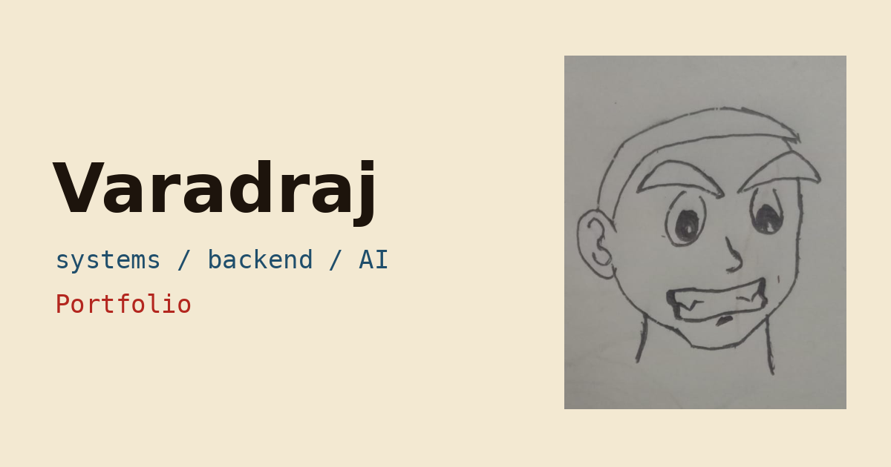

# Varadraj | Portfolio

A multi-page developer portfolio built around one idea: a systems engineer's site should feel like a system. The home page is a living peer-to-peer network you can click through, the projects explain themselves with interactive models, and a working terminal runs alongside the normal navigation.

Built for the **Portfolio Design Hackathon 2026** (Skillinf, on Unstop).



**Live site:** https://portfolio-theta-inky-86.vercel.app/

---

## Highlights

**A network as the hero.** The landing page draws a small peer-to-peer network that drifts and reacts to the cursor. The labelled nodes are real links: click one and a route pulse hops across the graph (found with a breadth-first search) before the page opens.

**A terminal that actually navigates.** It is a mini shell, not a decoration. `cd projects/p2p` opens that project, `ls` and `tree` list the site, `cat` summarises a project, and `open` jumps to a demo. It follows you onto every page as a collapsible dock, and a small runner game lives inside it. Some commands are hidden.

**Projects you can play with.** Each project has its own deep-linkable page with a consistent structure: problem, hardest part, build, architecture, and a short interactive model where it fits.

- *Distributed P2P storage:* a 16-node Kademlia-style lookup. Pick a key and watch each hop reduce the XOR distance until the key is found.
- *Bank transaction system:* a double-entry ledger demo that shows atomic transfers and idempotent retries, where resending a request never charges twice.
- Architecture diagrams draw themselves, stroke by stroke, as they scroll into view.

**Design that responds to the visitor.** The palette follows the visitor's local time of day (dawn, day, dusk, night) and the night palette doubles as dark mode. Interactions are deliberately tactile: magnetic buttons, a tilting portrait, an ink trail with splats on click, headlines that bleed into the page, and a wax seal that stamps onto each project.

**Calm mode.** Every effect can be switched off from the footer or with `calm` in the terminal. It starts enabled for visitors who prefer reduced motion.

## Pages

| Route | Content |
| --- | --- |
| `/` | Network hero, terminal, selected work, figures from the projects, education |
| `/projects` | Project index |
| `/projects/:slug` | Case study pages: P2P storage, bank ledger, GitHub Bounty |
| `/about` | Story, education, scroll-drawn path, skills |
| `/contact` | Links and resume |

Routing is hash-based, so every page is deep-linkable on any static host.

## Featured projects

- **Distributed Peer-to-Peer Storage Network** (Go, gRPC, React, Kademlia DHT, Protocol Buffers): decentralized, content-addressed storage with O(log N) peer discovery, SHA-256 chunking, Merkle DAGs, 3-way replication and self-healing heartbeats across 20 nodes.
- **Bank Transaction System** (Node.js, Express, MongoDB, JWT): a double-entry ledger with ACID transactions, idempotent transfers, immutable audit logs, token blacklisting and role-based authorization.
- **GitHub Bounty** (Next.js, TypeScript): a deployed web app that turns GitHub activity into a shareable visual profile.

## Tech stack

- **React 18** and **Vite** for the app and build
- **Plain CSS** with custom properties for theming, no UI framework
- **Canvas 2D** for the network and cursor ink, **SVG** for the diagrams and visualizers
- **Web Audio API** for the optional terminal sound, off by default
- Fonts: Pirata One, Figtree and JetBrains Mono

## Design and engineering decisions

- **Hash routing** keeps deployment trivial and gives every project a shareable URL without server rewrites.
- **No heavy dependencies.** The network, ink trail, visualizers and scroll effects are small hand-written modules, which keeps the bundle light.
- **Performance care:** the canvas pauses when off screen, theme colors are cached instead of read every frame, and the ink particle count is capped.
- **Accessibility:** skip link, focus moved to the new page on navigation, per-page titles, live regions in the visualizers, visible focus states, text contrast checked across all four palettes, and full support for reduced motion.
- **Responsive by default:** layouts collapse to a single column, and the network uses fewer nodes on small screens.

## Structure

```
src/
  App.jsx        routes, pages, theme and time-of-day logic
  Network.jsx    interactive network hero
  Terminal.jsx   shell commands and navigation
  Runner.jsx     terminal runner game
  Viz.jsx        P2P lookup, ledger demo, architecture diagrams, scroll path
  Ink.jsx        cursor ink trail
  data.js        all site content
  styles.css     theming and layout
```

## Author

**Varadraj** (Vara715), B.Tech in Computer Engineering (Software Engineering) at Vishwakarma Institute of Technology, Pune. Interested in backend and distributed systems, compilers and AI.

The portrait is a hand-drawn sketch.