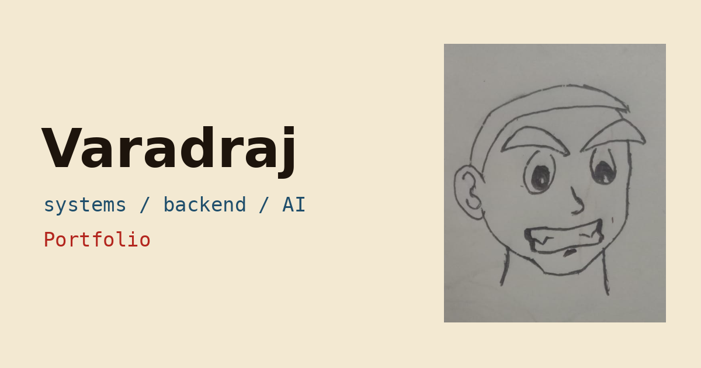

# Varadraj | Portfolio

A multi-page developer portfolio built around one idea: a systems engineer's site should feel like a system. The home page is a living peer-to-peer network you can click through, the projects explain themselves with interactive models, a working terminal runs next to the normal navigation, and a Chess page lets you play a bot I wrote from scratch.

Built for the **Portfolio Design Hackathon 2026** (Skillinf, on Unstop).



**Live site:** https://your-site-url

---

## For the reviewers

Everything below maps to the hackathon's judging criteria. A guided tour that takes about two minutes:

1. **Home:** move the cursor over the network, then click a labelled node (`~/projects`, `~/p2p`, `~/bank`). A route pulse travels across the graph and opens the page.
2. **Terminal on the home page:** type `help`, then `cd projects/p2p`. Press the backtick key on any page to open the docked terminal.
3. **A project page:** open the P2P page and run the lookup visualizer, then scroll to the architecture diagram as it draws itself.
4. **Chess page:** play Cheru, my bot, and check the live Chess.com stats.
5. **Time slider (nav, or footer on mobile):** drag it to watch the whole palette change from dawn to night.
6. **Calm mode (footer):** turns all motion and effects off, in case they get in the way.

| Criterion | How the site answers it |
| --- | --- |
| Creativity and originality | A clickable network as the hero, a terminal that actually navigates, a chess engine written from scratch, a palette that follows the visitor's time of day |
| UI/UX and visual appeal | An ink-and-parchment art direction, editorial typography, consistent light and dark themes, a deliberate balance of one bold hero and calm pages |
| Responsiveness | One-column mobile layouts, tap-to-move chess, a lighter network on small screens, touch-friendly controls |
| Functionality and navigation | Hash-based routing with deep links, a skip link, a command-line way to navigate, a docked terminal on every page, an in-site resume |
| Project presentation | A page per project with problem, hardest part, build, architecture diagram and an interactive model where it fits |
| Animations and interactions | Network, ink trail, scroll-drawn diagrams and path, count-ups, magnetic buttons, page transitions, all switchable off |
| Professional presentation | Per-page titles and meta tags, a printable resume page, accessibility work, and a Calm mode |

## Pages

| Route | Content |
| --- | --- |
| `/` | Network hero, terminal, selected work, figures from the projects, education |
| `/projects` | Project index |
| `/projects/:slug` | Case studies: P2P storage, bank ledger, GitHub Bounty |
| `/about` | Story, scroll-drawn path, education, achievements, skills |
| `/chess` | Play Cheru, live Chess.com stats, game replay |
| `/resume` | Resume in the browser, with download and print |
| `/contact` | Links and resume |

Routing is hash-based (`#/projects/p2p`), so every page is deep-linkable on any static host.

## Features

### The network hero
A small peer-to-peer network drifts across the landing page and reacts to the cursor. The labelled red nodes are real links. Clicking one runs a breadth-first search from "you" to that node and animates the path hop by hop before navigating. It pauses when scrolled off screen, uses fewer nodes on phones, and stops drifting in Calm mode.

### A terminal that navigates
A small shell, not a decoration. It is inline on the home page and becomes a collapsible dock on every other page, keeping its history as you move around. Press the backtick key to toggle it.

| Command | What it does |
| --- | --- |
| `help` | Lists the main commands |
| `cd <page>`, `cd ..`, `cd ~` | Moves between pages, for example `cd projects/bank` |
| `ls`, `pwd`, `tree` | Shows where you are and what is there |
| `cat <project>` | Summarises a project (`p2p`, `bank`, `github-bounty`) |
| `cat education`, `cat resume` | Prints education, or opens the resume PDF |
| `open <project>`, `open github` | Opens a live demo or a profile link |
| `about`, `projects`, `skills`, `education`, `contact`, `resume`, `chess`, `home` | Jumps straight to a page |
| `neofetch`, `whoami`, `history`, `date`, `echo` | The usual shell touches |
| `theme`, `sound`, `calm` | Switch light and dark, toggle optional sound (off by default), toggle Calm mode |
| `run` | A small animated runner game inside the terminal |
| `clear`, `exit` | Clear the screen, go home |

### Projects you can play with
Each project page follows the same template: problem, hardest part, build, architecture, and a short interactive model where it fits.

- **Distributed P2P storage:** a 16-node Kademlia-style lookup. Pick a key and watch each hop pick the known peer with the smallest XOR distance, so every hop fixes one more bit and a lookup takes at most log2(N) hops. It is a simplified model and says so.
- **Bank transaction system:** a double-entry ledger demo with atomic transfers and idempotent retries. Resend the same request and it is ignored, so nothing is charged twice.
- **Architecture diagrams** draw themselves, stroke by stroke, as they scroll into view.
- A **wax seal** stamps onto each project page.

### Chess
- **Play Cheru.** A tap-to-move board that highlights legal moves and the last move. Cheru is a hand-written engine using minimax with alpha-beta pruning, capture-first move ordering and a material evaluation. It runs in a Web Worker so the page never freezes. Three levels (Easy, Medium, Hard) set the search depth, and there is Undo and New game. Move rules and PGN parsing come from `chess.js`; the search and evaluation are my own code.
- **Live stats.** Rapid and Blitz ratings, best rating, win/loss/draw record and the five most recent games, pulled from the public Chess.com API in the browser. If the API is unreachable, the page falls back to a link to the profile.
- **Game replay.** A game I like is fetched by its Chess.com ID from the public archives, then can be stepped through, autoplayed or jumped through move by move. The board flips automatically when I played black.

### Design that responds to the visitor
- **Time-of-day palette.** The site picks dawn, day, dusk or night from the visitor's local clock. Night doubles as dark mode. A slider lets anyone preview the other times, and "Auto" returns to the real one.
- **Tactile interactions.** Magnetic buttons, a portrait that tilts in 3D, an ink trail that follows the cursor with splats on click, headlines that bleed into the page, count-up figures, and scroll reveals.
- **First-load intro.** A two-second moment where the name inks in, once per session, with a Skip button.
- **Scroll-drawn path.** On the About page, a route draws itself down the page and lights up each milestone.
- **In-site resume.** A clean, printable view built from the same content as the rest of the site.

### Calm mode
Every effect can be switched off from the footer or with `calm` in the terminal: the cursor ring and ink, tilt and magnetic buttons, reveals, the intro and background motion. It starts enabled for visitors whose system asks for reduced motion.

## Hidden features

A few things are not mentioned anywhere on the site.

| Try this | What happens |
| --- | --- |
| Konami code (up, up, down, down, left, right, left, right, B, A) | Toggles a rainbow mode across the hero and terminal |
| `gear5` in the terminal | The same rainbow mode, from the command line |
| `cmatrix` | Digital rain inside the terminal. Press Ctrl+C (or `q`, or Escape) to stop. Printable ASCII, as in the real tool |
| `sl` | A train passes through the terminal |
| `cowsay <text>` | The cow says it |
| `fortune` | A random engineering quote |
| `sudo`, `rm`, `vim`, `ssh`, `ping` | Each gets a reply of its own |
| Click anywhere | Ink splats at the cursor |
| Footer text | Names the palette currently in use |
| `sound` | Turns on a soft blip for terminal commands |

## How it is built

- **React 18** and **Vite** for the app and build
- **Plain CSS** with custom properties for theming and the four time-of-day palettes, no UI framework
- **Canvas 2D** for the network, ink trail and digital rain; **SVG** for the diagrams and visualizers
- **Web Worker** for the chess engine, **chess.js** for rules and PGN
- **Chess.com public API** for stats and the replay, called from the browser
- **Web Audio API** for the optional terminal sound
- Fonts: Pirata One, Figtree and JetBrains Mono

### Decisions worth noting
- **Hash routing** keeps hosting trivial and gives every project and page a shareable URL without server rewrites.
- **Few dependencies.** The network, ink trail, visualizers and scroll effects are small hand-written modules, and `chess.js` is the only runtime library besides React.
- **Performance:** canvases pause when off screen, theme colors are cached instead of read each frame, particle counts are capped, and the engine runs off the main thread.
- **Accessibility:** skip link, focus moved to the new page on navigation, per-page titles, live regions in the visualizers and chess status, visible focus states, text contrast checked across the four palettes, and full reduced-motion support.
- **Responsive by default:** layouts collapse to one column, the chess board is tap-to-move, and the effects that need a mouse are disabled on touch.

## Structure

```
src/
  App.jsx            routes, pages, theme, time-of-day logic, intro
  Network.jsx        interactive network hero
  Terminal.jsx       shell commands and navigation
  Runner.jsx         terminal runner game
  Matrix.jsx         cmatrix digital rain
  Viz.jsx            P2P lookup, ledger demo, architecture diagrams, scroll path
  Chess.jsx          board, play, live stats, replay
  engine.worker.js   chess engine (alpha-beta search)
  Ink.jsx            cursor ink trail
  data.js            all site content
  styles.css         theming and layout
```

## Featured projects

- **Distributed Peer-to-Peer Storage Network** (Go, gRPC, React, Kademlia DHT, Protocol Buffers): decentralized, content-addressed storage with O(log N) peer discovery, SHA-256 chunking, Merkle DAGs, 3-way replication and self-healing heartbeats across 20 nodes.
- **Bank Transaction System** (Node.js, Express, MongoDB, JWT): a double-entry ledger with ACID transactions, idempotent transfers, immutable audit logs, token blacklisting and role-based authorization.
- **GitHub Bounty** (Next.js, TypeScript): a deployed web app that turns GitHub activity into a shareable visual profile.
- Also built: **Behavioral Biometric Authentication System** (Python, Scikit-learn, Tkinter): mouse-dynamics authentication from four mini-games, 40+ features, Random Forest and SVM at 88.5% accuracy.

## Transparency

AI tools were used to assist development, as the hackathon allows. The projects, content, design direction and choices are mine, and I reviewed and customised the result. Cheru's search and evaluation code is original; chess rules come from the open-source `chess.js`.

## Author

**Varadraj** (Vara715), B.Tech in Computer Engineering (Software Engineering) at Vishwakarma Institute of Technology, Pune. Interested in backend and distributed systems, compilers and AI.

The portrait is a hand-drawn sketch.